<div align="center">


<p>
  <a href="https://colab.research.google.com/github/jf-floresriera/caucho_san_carlos/blob/main/Analisis_SanCarlos_clima_cultivo.ipynb"></a>
  
  
  
  
  
</p>

</div>


# 🌳 Resumen

Análisis del clima del **lote San Carlos** (4°11'15.52" N, 72°32'14.55" O; San Carlos de Guaroa, Meta) y su relación con la fenología y las enfermedades foliares del caucho (*Hevea brasiliensis*). Se estudian los clones **FX 3864**, **IAN 873** y **RRIM 600** (96 árboles, 2016–2020), con énfasis en **enero–abril**: defoliación invernal → refoliación → maduración de la hoja.

Preguntas que responde el cuaderno:

| # | Pregunta | Sección |
|---|---|---|
| 1 | ¿Se pueden correlacionar los datos de la estación IDEAM **La Palomera** con **CHIRPS** y **ERA5** de enero a abril? | 3 |
| 2 | ¿La información **cada 8 días** presenta cambios? | 6 |
| 3 | ¿Cómo evolucionan la **incidencia** de SALB y Antracnosis en los campos clonales, y qué clima la explica? | 7–8 |

### 📍 Lote y estación de referencia

| | Latitud | Longitud |
|---|---|---|
| **Lote San Carlos** | 4°11'15.52" N | 72°32'14.55" O |

**La Palomera AUT [35185010]** está a **8.6 km** y es la **única estación climática activa cerca del lote**. Según el catálogo del IDEAM, la siguiente estación con temperatura y humedad está a casi 40 km (Hacienda Las Margaritas). Las intermedias son pluviométricas, limnimétricas o están suspendidas. Por eso La Palomera es la referencia observada para validar los productos y corregir la humedad.

| Estación | Categoría | Estado | Distancia |
|---|---|---|---|
| **La Palomera AUT** | Agrometeorológica, automática | Activa | **8.6 km** |
| Fundo Nuevo Humapo | Pluviométrica | Activa | 22.5 km |
| Cabuyaro | Meteorológica especial | Suspendida | 30.3 km |
| Lajitas | Climatológica ordinaria | Suspendida | 38.4 km |
| Hacienda Las Margaritas AUT | Climatológica principal | Activa | 39.9 km |

Todo está en un solo cuaderno documentado celda por celda: [`Analisis_SanCarlos_clima_cultivo.ipynb`](Analisis_SanCarlos_clima_cultivo.ipynb).


# 🛰️ Aportes y resultados

### 1 · Validación de los productos con La Palomera (enero–abril)

La estación está a **8.6 km** del lote. A escala diaria el acuerdo es moderado. Al agregar a **8 días** o a un **mes**, la humedad y la lluvia mejoran mucho. La lluvia diaria casi nunca coincide entre satélite y pluviómetro, porque las tormentas convectivas son muy locales.

<div align="center"></div>

<details><summary>📊 Ver figuras de la validación</summary>

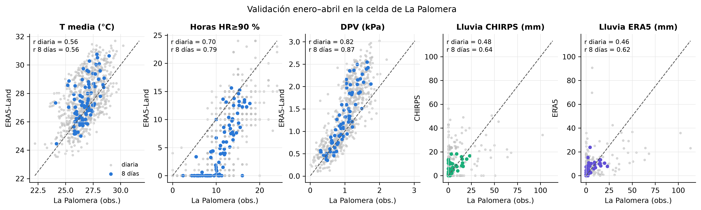
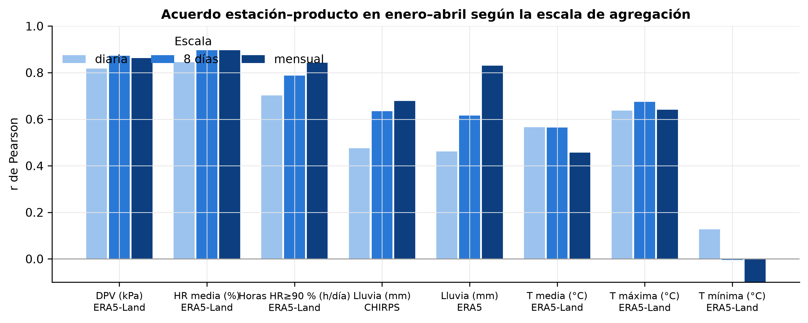
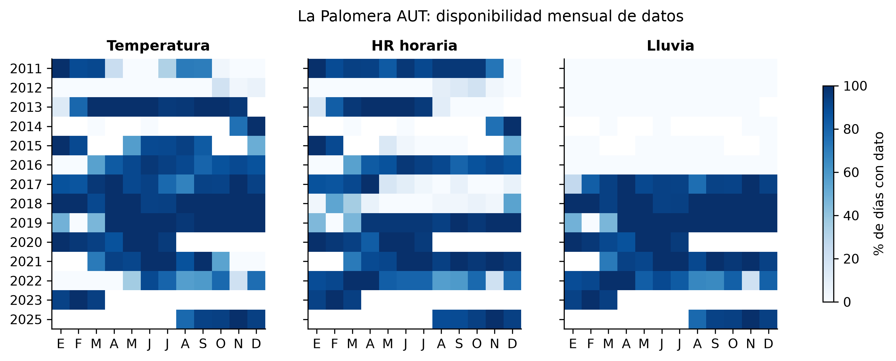
</details>

### 2 · Brillo solar: validación regional con Las Margaritas

La Palomera **no mide brillo solar**. Por eso ERA5 se validó en la celda de **Hacienda Las Margaritas AUT [35125010]** (Puerto López), la estación más cercana que lo mide, a **39.9 km** del lote.

| Enero–abril | r diaria | r 8 días | r mensual | Sesgo |
|---|---|---|---|---|
| ERA5 vs. Las Margaritas | 0.41 | 0.43 | 0.26 | **+5.1 h/día** |

- ✅ ERA5 reproduce el **ciclo estacional**: enero–febrero es lo más soleado y junio–julio lo menos.
- ❌ Sobreestima unas 5 h y muchas veces se queda pegado cerca de 12 h, el máximo posible. Sigue poco las diferencias entre días y entre años.
- ⚠️ **Limitación:** es una validación **regional (40 km), no local**. Las relaciones del brillo solar con la enfermedad son **exploratorias**.

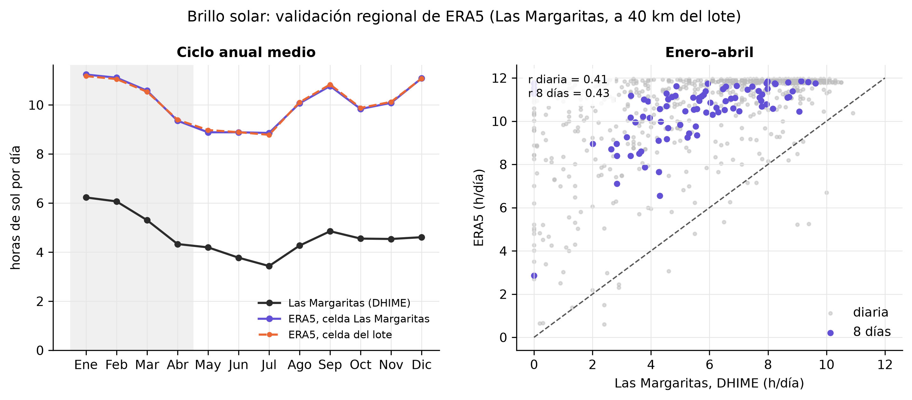

### 3 · Problema del sensor de temperatura de La Palomera

En **2011–2012** el sensor registró medias diarias de **12–15 °C**, imposibles en los Llanos. Se conservan **las dos versiones**, con y sin filtro, y se documenta el efecto:

| | r T media vs. ERA5-Land (ene–abr, diaria) |
|---|---|
| Sin filtro | 0.27 |
| Con filtro | **0.56** |

En los años del cultivo (2016–2020) no hay días afectados, así que la relación con el cultivo no cambia (Δρ = 0). La serie oficial de DHIME permite comprobar si el IDEAM ya corrigió esos días.

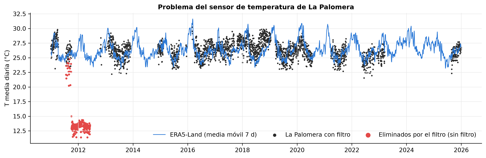

### 4 · Corrección de la humedad de ERA5-Land

ERA5-Land da noches demasiado secas. Con un **mapeo de cuantiles** por mes y bloque de 3 horas, entrenado con La Palomera y validado de forma cruzada por años, el sesgo de las horas con HR ≥ 90 % en enero–abril pasa de **−6.0 a +1.1 h/día**.

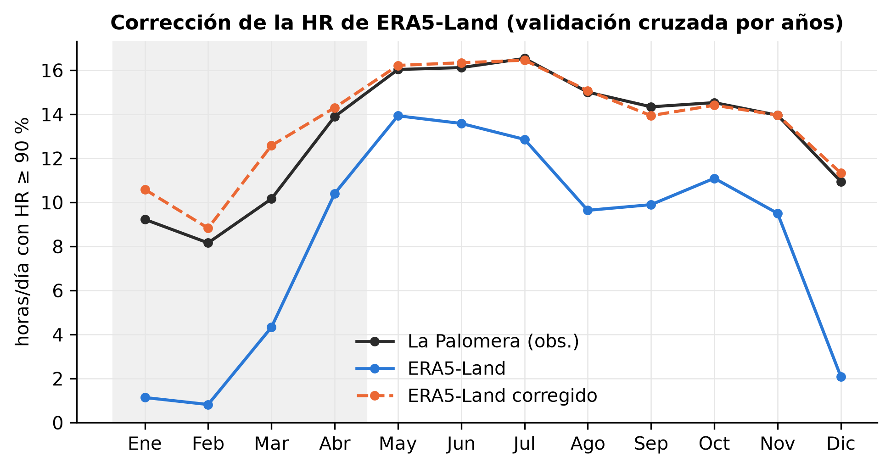

### 5 · ¿Cambia el clima cada 8 días?

**Sí, para la temperatura, la humedad y el DPV.** El periodo de 8 días explica entre el 57 % y el 71 % de la varianza (η²), y entre el 27 % y el 42 % de los pasos de un periodo al siguiente son significativos (Mann–Whitney; por azar se esperaría ~5 %). La lluvia es más errática: η² = 0.29 y solo el 8 % de los pasos son significativos.

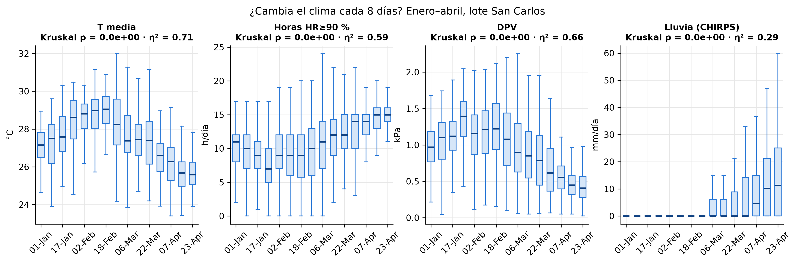

<details><summary>📊 Climatología del lote y enero–abril por años</summary>

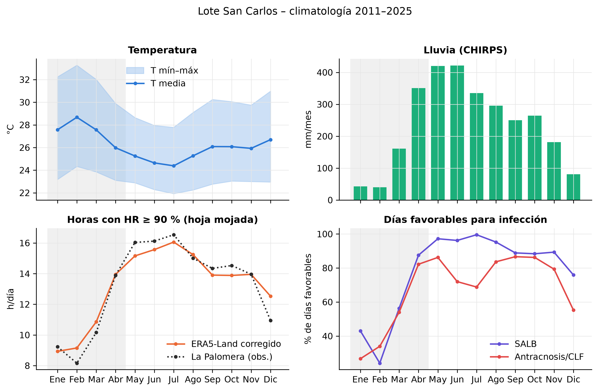
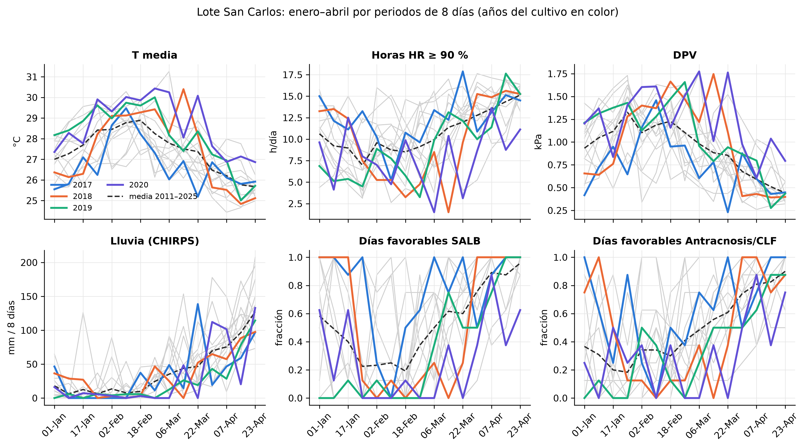
</details>

### 6 · Incidencia de enfermedades en los campos clonales

Para cada clon y fecha se calculan la incidencia, la severidad y el índice de McKinney, junto con los estados de la hoja (A, B, C, D), el área bajo la curva de progreso de la enfermedad (ABCPE), la necromasa y el LAI.

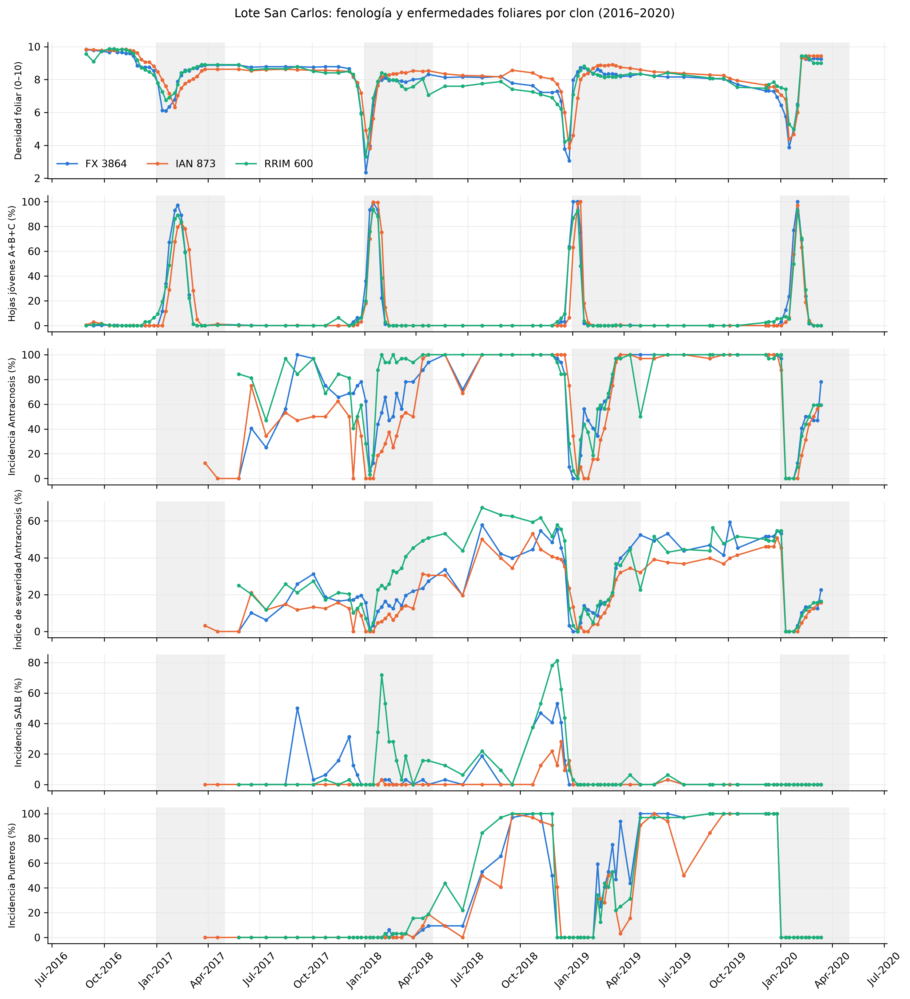

<details><summary>📊 ABCPE, necromasa y LAI</summary>

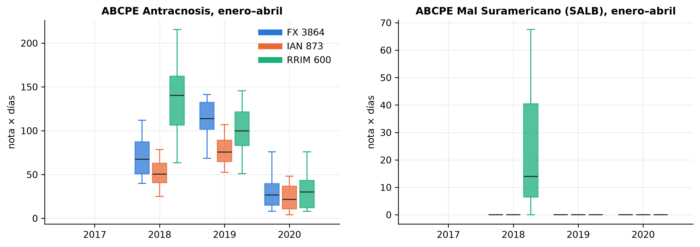
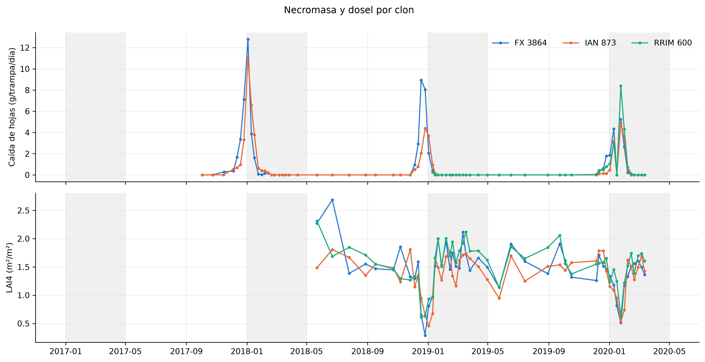
</details>

### 7 · Clima × enfermedad

- **Antracnosis:** la incidencia sube con la **temperatura de 25–32 días antes** (ρ = +0.55; p_FDR = 0.051, en el límite). En el modelo GEE a nivel de árbol:
  - una desviación estándar más de T media en esa ventana multiplica las probabilidades de que el árbol esté enfermo por **OR = 2.05**;
  - **IAN 873** es el clon menos afectado (OR = 0.47).
- **SALB:** **RRIM 600** concentra la enfermedad (OR = 22). Los días favorables a SALB de 9–16 días antes aumentan el riesgo (OR = 1.42).
- Con 3 temporadas (2018–2020), los resultados son **exploratorios**.

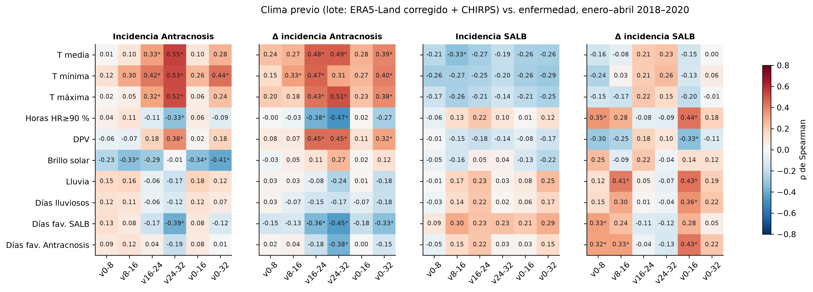
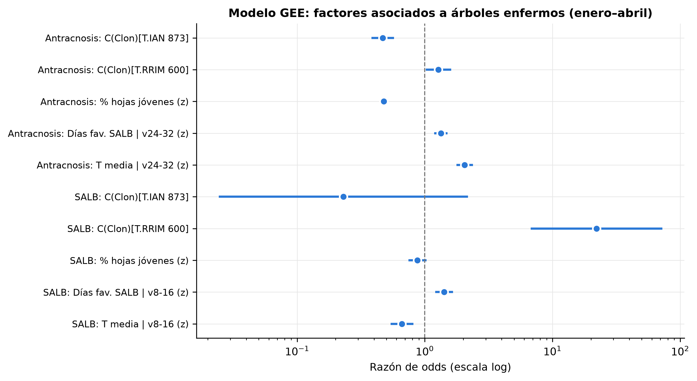

### 8 · Secuencia anual: clima → caída de hojas → brotación → enfermedad

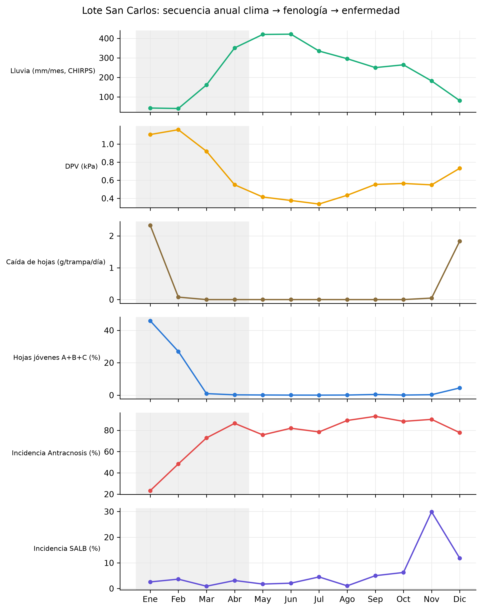


# 🔁 Reproducibilidad

El cuaderno contiene **toda la metodología de descarga**. En la celda 0.2 se elige el modo:

| `MODO_DATOS` | Qué hace | Tiempo |
|---|---|---|
| `"reutilizar"` *(por defecto)* | Usa los datos congelados de [`datos_crudos/`](datos_crudos/) y reproduce exactamente las cifras de este repositorio. | ~2 min |
| `"descargar"` | Baja **todo** otra vez desde las fuentes originales a `datos_crudos_descarga_AAAA-MM-DD/`, sin borrar nada. | 15–40 min |

Cada archivo queda registrado en [`datos_crudos/metadatos_descarga.json`](datos_crudos/metadatos_descarga.json) con:
- fuente, URL y parámetros exactos de la consulta;
- fecha de descarga;
- celda del modelo;
- huella **SHA-256**.

| Fuente | Acceso | Variables |
|---|---|---|
| ERA5-Land (ECMWF/Copernicus) | API Open-Meteo, `models=era5_land` | T, HR, punto de rocío (horario, 9 km) |
| ERA5 | API Open-Meteo, `models=era5` | lluvia, radiación, **brillo solar**, ETo (diario) |
| CHIRPS v2.0 | API ClimateSERV | lluvia (diaria, 5 km) |
| IDEAM La Palomera AUT [35185010] | datos.gov.co (`uext-mhny`, `sbwg-7ju4`, `ccvq-rp9s`, `afdg-3zpb`, `s54a-sgyg`) | HR, T, T máx, T mín, lluvia |
| IDEAM DHIME | descarga manual (no tiene API) | HR diaria oficial (La Palomera no reporta brillo solar ni lluvia en DHIME) |

### ¿Qué subir a Google Drive para usarlo en Colab?

```
MyDrive/tapiero/
├── Fenologia_base Orinoquia.xlsx                  ← siempre (no está en este repositorio)
└── san_carlos/                                    ← este repositorio
    ├── Analisis_SanCarlos_clima_cultivo.ipynb
    └── datos_crudos/
        ├── palomera/dhime/DHIME_HR_LaPalomera.xlsx  ← ya incluido
        └── (resto)                                ← solo para el modo "reutilizar"
```

> 🔒 **Los datos de campo** (`Fenologia_base Orinoquia.xlsx`) no se publican aquí hasta que salga el artículo. Hay que ponerlos en la carpeta **padre** del repositorio.

### ¿Qué registra La Palomera?

Revisado en datos.gov.co y en [DHIME](http://dhime.ideam.gov.co/atencionciudadano/) el 27-oct-2026:

| Variable | Sensores automáticos (datos.gov.co) | DHIME (diaria oficial) |
|---|---|---|
| Humedad relativa | ✅ horaria | ✅ (en `datos_crudos/palomera/dhime/`) |
| Temperatura media, máxima y mínima | ✅ horaria | no se usa |
| Precipitación | ✅ cada 10 min, desde 2017 | ❌ no la reporta |
| Brillo solar | ❌ | ❌ la estación no lo registra |

- **Lluvia:** se usa el pluviómetro automático, que cubre todos los años del cultivo. *Día pluviométrico*, total mensual y total anual son parámetros DHIME de estaciones convencionales y no existen para La Palomera.
- **Brillo solar:** se usa ERA5, validado de forma **regional** con Hacienda Las Margaritas (Puerto López, a 39.9 km), cuyo Excel DHIME está en `datos_crudos/margaritas/dhime/`. Ver el aporte 2.


# 🗂️ Estructura

```
Analisis_SanCarlos_clima_cultivo.ipynb   cuaderno principal (Colab o local), con salidas
datos_crudos/                            datos congelados + metadatos_descarga.json
  sancarlos/  palomera/  margaritas/  chirps_diario.csv
resultados/
  Base_SanCarlos_clima_cultivo.xlsx      todas las tablas (hoja LEEME)
  figuras/                               figuras PNG a 300 dpi
scripts/
  construir_cuaderno.py                  genera el cuaderno (fuente del texto y el código)
  ejecutar_cuaderno.py                   lo ejecuta en local
  descargar_socrata_reanudable.py        descarga de datos.gov.co año por año, reanudable
  fix3.py … fix5.py                      parches aplicados (trazabilidad de los cambios)
assets/readme/                           banner y gráficos animados de este README
```

**En local:**
```bash
pip install pandas numpy scipy statsmodels matplotlib requests openpyxl nbformat nbclient ipykernel
python scripts/construir_cuaderno.py Analisis_SanCarlos_clima_cultivo.ipynb   # (opcional) regenerar
python scripts/ejecutar_cuaderno.py
```


# 🧭 Historial

| Versión | Cambios |
|---|---|
| **v2** | Análisis base: validación ene–abr, corrección de HR, cambios cada 8 días, clima × enfermedad, problema del sensor de T. |
| **v3** | Protocolo de descarga reproducible (modos, SHA-256), T máx/mín de sensores de extremos, brillo solar, lector y validación DHIME, descarga reanudable de datos.gov.co. |
| **v3.1** | La Palomera es la única estación climática cerca del lote; validación regional del brillo solar de ERA5 con Hacienda Las Margaritas (40 km). |

Al agregar T máxima y brillo solar crece el número de pruebas. Por eso los p_FDR de la v3 difieren algo de los de la v2: el mejor pasa de ≈ 0.066 a 0.051. Los ρ no cambian.


# 📚 Referencias

- Funk, C. et al. (2015). *Scientific Data* 2, 150066. CHIRPS.
- Hersbach, H. et al. (2020). *Q. J. R. Meteorol. Soc.* 146, 1999–2049. ERA5.
- Muñoz-Sabater, J. et al. (2021). *Earth Syst. Sci. Data* 13, 4349–4383. ERA5-Land.
- Zippenfenig, P. (2023). Open-Meteo.com Weather API. Zenodo, doi:10.5281/zenodo.7970649.
- Métodos: McKinney (1923); Shaner & Finney (1977); Liang & Zeger (1986); Benjamini & Hochberg (1995); Themeßl et al. (2011); Hallé et al. (1978).

Trabajo relacionado: [hevea-agroclima-salb-clf](https://github.com/jf-floresriera/hevea-agroclima-salb-clf) (Las Delicias y C.I. Taluma).

<div align="center">
<br>

<br><sub>Jesús Enrique Flores Riera · Universidad Nacional de Colombia</sub>
</div>
